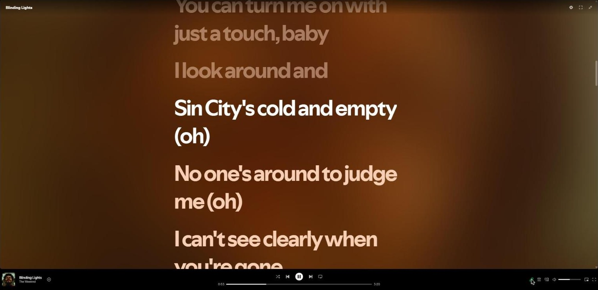
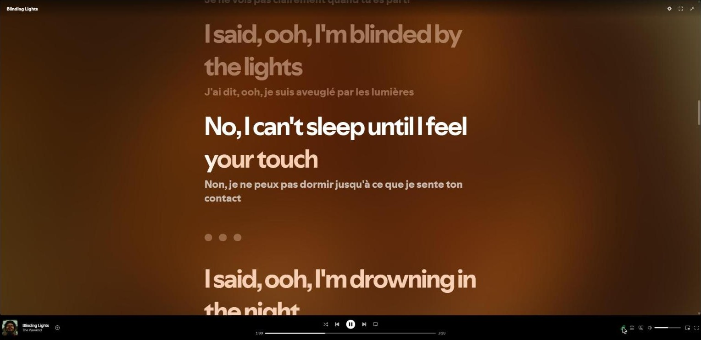
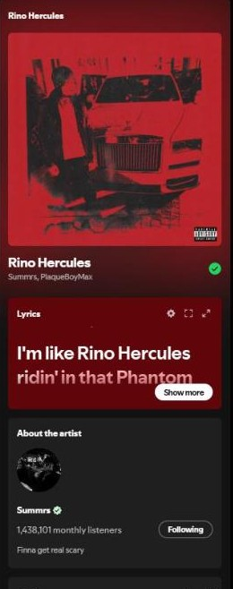
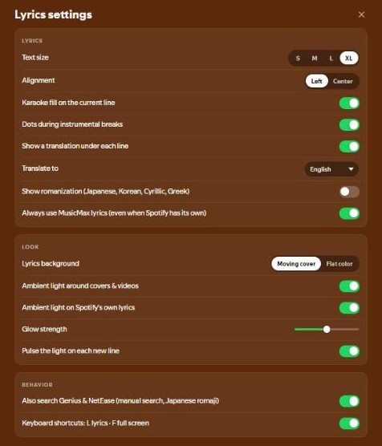

<div align="center">


<h1>MusicMax</h1>

<p><b>Lyrics for the songs Spotify Web is missing.</b><br>
When Spotify says <i>"Looks like we don't have the lyrics for this song"</i>, MusicMax finds them, synced to the music,<br>
and shows them exactly where Spotify would, with karaoke, translations and ambient light.</p>

<a href="https://chromewebstore.google.com/detail/musicmax/ofhnlejlgcdpbbcbchlgeoeiljaageij" target="_blank"></a>

<br><br>

<a href="https://chromewebstore.google.com/detail/musicmax/ofhnlejlgcdpbbcbchlgeoeiljaageij"></a>
<a href="https://chromewebstore.google.com/detail/musicmax/ofhnlejlgcdpbbcbchlgeoeiljaageij"></a>
<a href="https://chromewebstore.google.com/detail/musicmax/ofhnlejlgcdpbbcbchlgeoeiljaageij/reviews"></a>
<a href="https://buymeacoffee.com/thock"></a>

<br><br>



</div>

---

## It looks like Spotify. Because it's built into Spotify.

MusicMax doesn't open a popup window or float a panel on top of the page. It switches on the
controls Spotify already has — the greyed-out **mic button**, the **lyrics tab** of the expanded
Now Playing view and the **Lyrics card** in the sidebar — and draws lyrics in Spotify's own fonts,
sizes and colors, tinted from the album cover. Most people won't notice anything was added. They'll just
notice the lyrics are there.

## Features

<table>
<tr>
<td align="center" width="33%">
<br>

<br>
<b>Missing lyrics, found</b><br>
Spotify's disabled mic comes back to life with synced lyrics from LRCLIB, plus Genius and NetEase if you turn them on.<br><br>
<code>No lyrics</code> → <code>Synced lyrics</code>
<br><br>
</td>
<td align="center" width="33%">
<br>

<br>
<b>Ambient light</b><br>
A YouTube-style glow around covers and videos, and the cover slowly turning behind the lyrics.<br><br>
<code>Flat color</code> → <code>Living light</code>
<br><br>
</td>
<td align="center" width="33%">
<br>

<br>
<b>Karaoke fill</b><br>
White sweeps across each line at the song's own pace, slow ballad or fast verse, even on Spotify's own lyrics.<br><br>
<code>Line by line</code> → <code>Sung along</code>
<br><br>
</td>
</tr>
<tr>
<td align="center">
<br>

<br>
<b>Translation</b><br>
A translated line under every lyric, in 14 languages, done on your computer by Chrome's built-in translator.<br><br>
<code>夜に駆ける</code> → <code>Racing into the night</code>
<br><br>
</td>
<td align="center">
<br>

<br>
<b>Romanization</b><br>
Sing along to Japanese, Korean, Cyrillic and Greek.<br><br>
<code>사랑해</code> → <code>saranghae</code>
<br><br>
</td>
<td align="center">
<br>

<br>
<b>Share a line</b><br>
Right-click any lyric to copy or save it as an image card in the song's colors.<br><br>
<code>Right-click</code> → <code>Ready to post</code>
<br><br>
</td>
</tr>
</table>

**And also:** click a line to jump the song there · dots that fill up during instrumental breaks ·
full-screen lyrics · a "Wrong lyrics?" search that remembers your pick · 500 songs saved for
instant replays · optional "Always use MusicMax lyrics" mode · one button to turn everything off ·
and a ✨ **Secret** section at the bottom of the settings (stars in the song's colors; we'll let you find out).

## What's new in 3.5

- **Karaoke that keeps up.** The fill now learns each song's pace from its own timings, so it no
  longer crawls through a rap verse or races ahead of a ballad.
- **More songs found.** With Genius & NetEase turned on, they're tried automatically whenever LRCLIB
  has nothing. The "No lyrics found" screen offers to turn them on.
- **Smoother ambient light.** The blur now runs in tiny canvases on the graphics card, so scrolling stays smooth.
- **A welcome page** on first install, and the ✨ Secret section.

## Screenshots

| Translation and instrumental-break dots | Sidebar card and cover glow |
| :---: | :---: |
|  |  |

| Settings, right inside Spotify |
| :---: |
|  |

## How to use it

1. Install MusicMax and open [open.spotify.com](https://open.spotify.com).
2. Play a song. If Spotify has no lyrics, the mic button lights up anyway: click it.
3. Open settings with the **gear** in the lyrics view, on the sidebar card, or from the MusicMax icon in your browser's toolbar.
4. Nothing found? Click **Search manually**, or **Also search Genius & NetEase** to let MusicMax look further.

| Shortcut | Action |
| :---: | :--- |
| <kbd>L</kbd> | Open / close lyrics |
| <kbd>F</kbd> | Full screen |
| <kbd>Esc</kbd> | Close |
| Right-click a line | Share it as an image |
| Click a line | Jump the song there |

Shortcuts are ignored while you type (Spotify's search box, settings, the lyrics search).

## Where the lyrics come from

Songs are looked up on **[LRCLIB](https://lrclib.net)**, an open, community-run lyrics database
with a public API. Synced lyrics are used when they match the recording you're playing.

**Genius** and **NetEase** are off by default; your browser asks before allowing them. Once on,
they're tried automatically when LRCLIB has nothing, join the manual search, and give Japanese romaji.

## Privacy

MusicMax sends only the **song title, artist and length** to the lyrics service, plus the
cover image address to pick colors. No account, no tracking, no analytics, nothing sold.
Translations run **on your computer**. Settings and saved lyrics stay in your browser.
Full policy: [store/privacy-policy.md](store/privacy-policy.md).

## Install

**Chrome Web Store (recommended):** [MusicMax](https://chromewebstore.google.com/detail/musicmax/ofhnlejlgcdpbbcbchlgeoeiljaageij).
Works in Chrome, Edge, Brave and other Chromium browsers.

**Firefox:** coming soon to Firefox Add-ons. Translation is Chrome-only (it uses Chrome's built-in
translator); everything else works the same.

<details>
<summary><b>Manual install (developer mode)</b></summary>

1. Download this repository (Code → Download ZIP) and unzip it.
2. Open `chrome://extensions` and turn on **Developer mode**.
3. Click **Load unpacked** and pick the folder.
4. Reload [open.spotify.com](https://open.spotify.com).

</details>

## FAQ

**Does it change Spotify when Spotify already has lyrics?**
No, Spotify's lyrics stay; MusicMax only adds the ambient light, translation and karaoke fill
on top (each can be switched off). Turn on *Always use MusicMax lyrics* if you prefer MusicMax's view everywhere.

**Does it work in the Spotify desktop app?**
No, only the web player at open.spotify.com.

**Will it slow Spotify down?**
No. Effects you switch off don't run at all, and nothing is drawn while the tab is hidden.
If your computer struggles, turn off the ambient light first.

**The karaoke fill isn't exactly on the words.**
Synced lyrics only say when each *line* starts, so MusicMax estimates how the words are spread
from the song's pace. It's close, not perfect: a long held note can put it slightly ahead.

**A song shows the wrong lyrics.**
Scroll to the bottom of the lyrics and click **Wrong lyrics?** to pick the right one. Your choice is remembered.

**Is it made by Spotify?**
No. MusicMax is an independent project and isn't affiliated with or endorsed by Spotify.

---

<details>
<summary><b>For developers</b></summary>


### Debugging

- Lines starting with a green **[SGL]** in the Spotify tab's DevTools console come
  from the extension. Each song gets one line saying what was found and where.
- To print the background log in that console, run:
  `postMessage({ type: "SGL_DUMP_LOG", last: 40 }, "*")`
- After loading, the extension logs a warning if any Spotify page element it relies
  on is still missing after three checks. That's the first sign Spotify changed its page.

### Tests

```
npm test            # unit + break-it tests (no network), Node 20+
npm run test:live   # real lookups against LRCLIB, Genius and NetEase
npm run icons       # redraw icons/*.png
npm run package     # dist/musicmax-<version>.zip (Chrome) and -firefox.zip
```

### Publishing

`store/` holds the Chrome Web Store listing text, permission justifications, data-use
answers, the privacy policy and a checklist of what is left to do by hand.

### Layout

| Path | Purpose |
| --- | --- |
| `manifest.json` | Extension manifest (MV3) |
| `background/index.js` | Service worker: message handlers, wiring |
| `background/lookup.js` | Asks the sources, picks the winner, writes the trace |
| `background/sources/*.js` | LRCLIB (automatic), Genius and NetEase (opt-in: fallback, manual search, romaji) |
| `background/match.js` | Title cleanup and match scoring |
| `background/lrc.js` | Parsing timed (LRC) and plain lyrics |
| `background/cache.js` | Saved lyrics (LRU, expiry, hand-picked) |
| `background/color.js` | Colors from the cover art |
| `background/log.js`, `http.js` | Debug log; fetch with timeout and retry |
| `content/spotify.js` | **Everything that reads Spotify's page**: the file to fix when Spotify changes |
| `content/main.js` | Main loop: track changes, loading, the mic and tab clicks |
| `content/view.js`, `card.js`, `picker.js`, `lyrics.js` | The big view, sidebar card, "Wrong lyrics?" panel, lyric lines |
| `content/sync.js` | Following the song's position (pauses, seeks); karaoke pace per song |
| `content/ambient.js` | Ambient light around media and behind Spotify's lyrics |
| `content/spotify-lyrics.js` | Translation, romanization, karaoke fill and stars on Spotify's own lyrics |
| `content/sparkles.js` | The ✨ Secret effects (line stars, cursor trail), idle while off |
| `content/share.js` | "Share this line" image cards |
| `content/lang.js` | Language detection, romanization, Chrome's translator |
| `content/settings.js` | The settings list and its controls (page panel and popup) |
| `content/core.js` | Shared helpers, logging, console debugging hooks |
| `content.css`, `settings.css` | Page styles; settings controls |
| `popup/` | Toolbar popup |
| `welcome/` | Page shown once after install |
| `icons/` | Extension icons (drawn by `scripts/make-icons.mjs`) |
| `scripts/` | Icon drawing and store packaging |
| `store/` | Store listing, privacy policy, submission checklist (not shipped) |
| `tests/` | Node tests |

### If it stops working

Spotify changes its page from time to time. The extension relies on these
`data-testid` attributes: `now-playing-widget`, `context-item-info-title`,
`context-item-info-artist`, `lyrics-button`, `playback-position`,
`playback-duration`, `progress-bar`, `global-nav-bar` and `now-playing-bar`.
It also relies on the expanded view's tab group (`[role="radiogroup"]`) and on the
right-hand `<aside>` holding a column of `<section>` cards. All of them live in
`content/spotify.js`.

</details>

---

<div align="center">

<a href="https://chromewebstore.google.com/detail/musicmax/ofhnlejlgcdpbbcbchlgeoeiljaageij/reviews"></a>
<a href="https://buymeacoffee.com/thock"></a>

<p><i>If MusicMax gave you lyrics Spotify couldn't, a ⭐ on GitHub or a review on the store goes a long way.</i></p>

</div>
